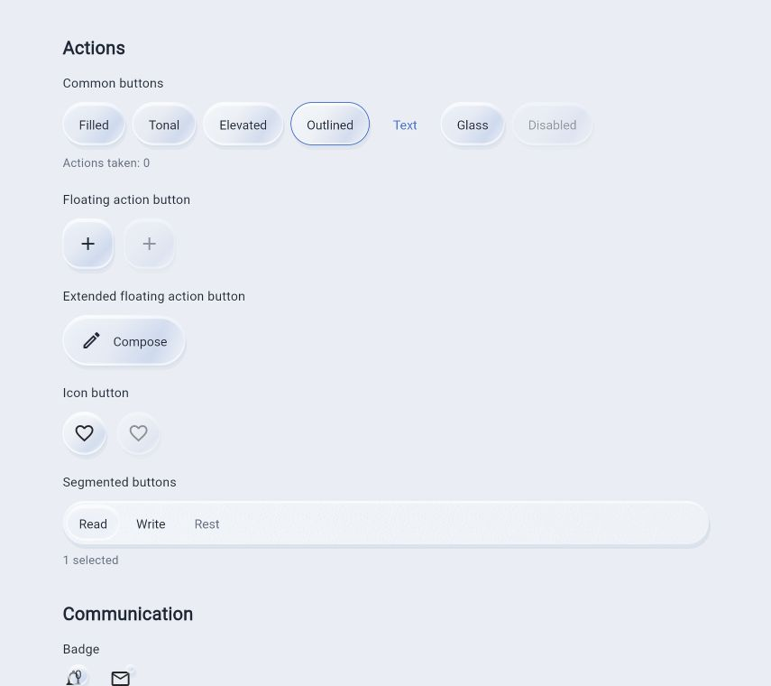
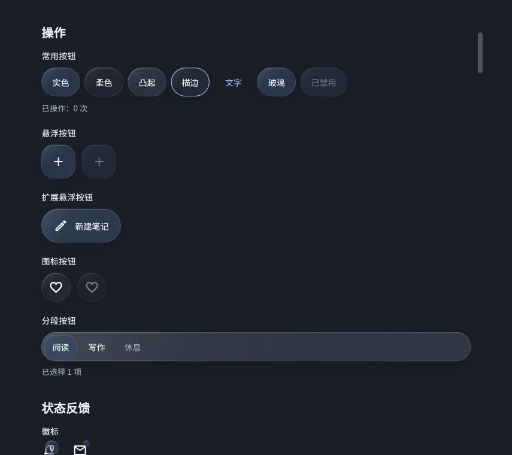

# 当前控件视觉参考

2026-10-02 本地Flutter Web示例截图。示例展示可操作状态，截图只证明此场景的外观；不是全平台golden或性能验收。

## 浅色雕刻材质

按钮、悬浮操作、图标按钮和分段选择；凹槽稳定、镜片独立，禁用项保留轮廓但不响应。

## 深色清透液态材质

同组组件的清透模式：无颗粒、柔和阴影与薄边缘；中文主体清晰。减少透明度/高对比时应使用不透明替代，不能仅依赖此截图认可所有材质组合。
