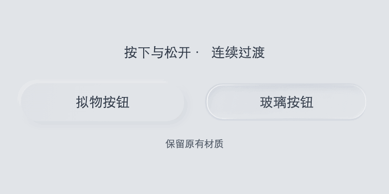

# 控件视觉参考

下方两张为 2026-10-02 的历史 Flutter Web 示例截图，保留用于既有雕刻/清透分支参考，并非 v0.3 轻拟态最新截图。示例展示可操作状态，截图只证明此场景的外观；不是全平台golden或性能验收。

## 浅色雕刻材质

按钮、悬浮操作、图标按钮和分段选择；凹槽稳定、镜片独立，禁用项保留轮廓但不响应。

## 深色清透液态材质

同组组件的清透模式：无颗粒、柔和阴影与薄边缘；中文主体清晰。减少透明度/高对比时应使用不透明替代，不能仅依赖此截图认可所有材质组合。

## 2026-10-31 连续压力：轻拟态与玻璃

来自 Flutter 实际组件逐帧渲染：左右分别为轻拟态与玻璃按钮，展示静止、按压中间态、按下及松开。不是设备录像，不构成帧率测量；该图不覆盖深色、全部组件或全部无障碍分支。

[静止](assets/press-rest.png) · [中间态](assets/press-middle.png) · [按下](assets/press-held.png)。源素材及指纹见[实现基线](../08-platforms/implementation-baseline.json)。
